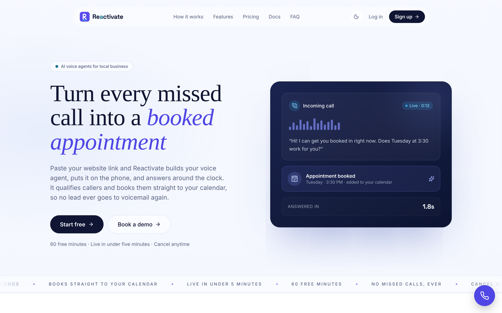
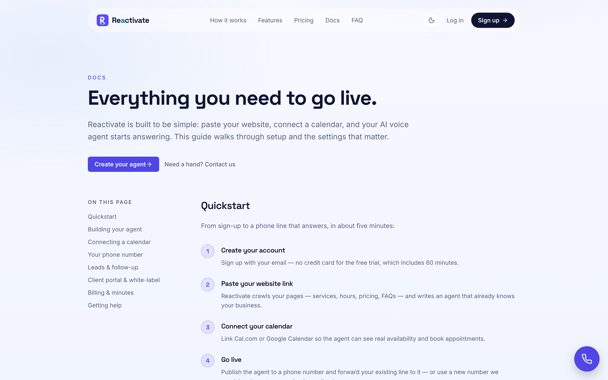

# Portfolio — El Mailoudi Hassan

Freelance software engineer building **operations systems and AI automation** for
local-service businesses: the unglamorous plumbing that turns a missed phone call
into a booked, paid appointment.

Below is the flagship project. Source is private; this page is the walkthrough.

---

## Reactivate — AI voice agents for local business

**[reactivate.cc](https://reactivate.cc)** · production SaaS, built and operated solo

A local business misses roughly a third of its inbound calls — after hours, mid-job,
or while already on the phone. Each one is a customer who rings the next name on the
list. Reactivate answers every call with an AI voice agent that sounds like a person,
qualifies the caller, and books them straight into the calendar.

The onboarding is the product's sharpest edge: **paste your website URL.** Reactivate
crawls the site, extracts services, hours and pricing into a knowledge base, provisions
a phone number, and has a trained agent answering live — in under five minutes, with no
scripting by the owner.

<p align="center">
  
</p>

<p align="center">
  
  <br><em>Setup is four steps; the product documentation is part of the product.</em>
</p>

### What it does

| | |
|---|---|
| **Voice agents** | Inbound and outbound calls over Retell, with per-agent voice, latency, interruption sensitivity and backchannel tuning |
| **Website chatbot** | The same agent as an embeddable widget — one `<script>` tag on any site |
| **Zero-config setup** | Website crawl → knowledge base → provisioned number → live agent |
| **CRM & pipelines** | Contacts, leads, deals, drag-and-drop stage board |
| **Booking** | Public booking pages with availability rules; two-way sync to Google, Microsoft and Cal.com |
| **No-show recovery** | Detects no-shows and runs win-back sequences automatically |
| **Reactivation campaigns** | Outbound dialer that works a dormant customer list back into bookings |
| **Automations** | Trigger/action workflows, generated from a plain-English description |
| **Funnels** | Landing-page and form builder with published public pages |
| **Reviews** | Review requests, AI-drafted replies, Google Business integration |
| **Client portal** | Scoped, tokenised view so an owner's own clients can see calls and appointments |
| **Billing** | Stripe subscriptions with pause, resume, cancel-with-reason and win-back |

### How it is built

```
Next.js 15 (App Router, RSC)  ──  Vercel
         │
         ├── Supabase Postgres + Auth + Storage
         │     └── row-level security on every tenant table
         │
         ├── Retell ........ voice agents, telephony, web calls
         ├── Anthropic ..... agent prompts, automation generation, review replies
         ├── Stripe ........ subscriptions and metered usage
         ├── Resend ........ transactional and campaign email
         └── Google / Microsoft / Cal.com ... calendar sync
```

**Multi-tenancy is enforced at the database, not in the handlers.** Every tenant table
carries RLS keyed to `auth.uid()`. Requests run through a cookie-scoped Supabase client
that physically cannot read another account's rows; the service-role client is reserved
for the narrow set of jobs that legitimately cross tenants, and is never reachable from
a request handler. Uploads extend the same idea — an object's *path* is the authorization
boundary, with the policy checking that the first folder segment is the uploader's own
user id, so a valid session still cannot write into someone else's folder.

**Ten scheduled jobs** carry the work that must happen whether or not anyone is logged in:
follow-ups every 15 minutes, the campaign dialer and automation runner every 5, agent-health
checks every 10, review sweeps, cancellation reconciliation, and a monthly summary.

**The embeddable widget** derives its own origin from the script's `src`, so the same tag
works unchanged across production, staging and preview deployments without a per-environment
build.

### Scale

| | |
|---|---|
| TypeScript / TSX files | **385** |
| Lines of application code | **~66,800** |
| API route handlers | **123** |
| Database tables | **42** |
| Versioned migrations | **23** |
| Scheduled jobs | **10** |

### Engineering notes

A few problems from this codebase that were more interesting than they looked:

- **`overflow-x: hidden` silently kills `position: sticky`.** Setting `hidden` on one axis
  computes the other to `auto`, which makes the element a scroll container and detaches every
  sticky descendant. The build stayed green and the automated checks passed — only frame-by-frame
  screenshots showed nothing was pinning. `overflow-x: clip` is the fix.
- **Contrast audits that walk the element tree miss `position: fixed` elements**, because their
  visual backdrop is a sibling rather than an ancestor. A shared navbar sat at 1.26:1 over a new
  hero and every automated check passed. Sampling composited pixels caught it.
- **Treating a failed query as an empty result** is how a dashboard tells a customer with ten
  agents to "create your first agent". A missing column and a genuinely empty table are not the
  same state and must not render the same way.
- **An avatar URL written by a client and rendered into an `` is not free text.** It is
  narrowed on write *and* again on read against a manifest and the project's own storage host,
  because the page renders onto third-party sites — the wrong place to trust a stored value.

### My role

Sole engineer and operator: product, architecture, implementation, database design,
deployment and on-call. From empty repository to paying customers.

---

## Contact

Available for freelance work on operations systems, AI automation, and SaaS builds.

**[reactivate.cc](https://reactivate.cc)** · [github.com/appsroket](https://github.com/appsroket)
